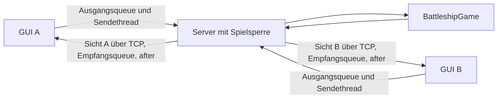

# Architektur und Datenfluss

Python >=3.12, Standardbibliothek. Der Spielkern kennt weder Sockets noch
Fenster. Der Server ist die verbindliche Quelle für Zustand und Aktionsprüfung.

| Datei | Aufgabe |
|---|---|
| `src/board.py` | Koordinaten, Flottenprüfung, Platzierung, Schüsse, Zugfolge, Sieg, gefilterte Kopien |
| `src/netz.py` | UTF-8-JSON-Zeilen senden/lesen, ungültige Objekte markieren, Verbindungsende behandeln |
| `src/server.py` | Spieler an Verbindungen binden, Sperre, private Antworten, Zustandsverteilung, Reset |
| `src/event_log.py` | Exklusiv erzeugtes JSONL-Metadatenlog, Schreibsperre, Flush und geschütztes Schliessen |
| `src/client_gui.py` | Eingaben senden, bestätigte Zustände vollständig anzeigen, GUI-Lebenszyklus |
| `src/sea_cell.py` | Canvas-Rasterfelder, Schiffsausschnitte, Schussmarkierungen und Tastaturbedienung |
| `src/ship_art.py` | Fünf SVG-Quellen laden, Grundformen skalieren und auf Canvas zeichnen |
| `src/ship_effects.py` | Neue eigene Schiffsverluste erkennen und zeitlich begrenzte lokale Sprengungen zeichnen |
| `src/play.py` / `src/client.py` | Konsolenspiel bzw. Lobbydiagnose |
| `src/local_game.py` | Spielkern an einer Tastatur bedienen |
| `src/echo_*.py` | Separater TCP-Grundversuch aus M0 |

## Server

Ein Thread pro Verbindung liest Nachrichten. Eine gemeinsame Sperre umfasst
Prüfen, Ändern und Senden. So wird kein freier Platz doppelt vergeben und
jede Zustandsmeldung gehört zur unter derselben Sperre ausgeführten Aktion.
Helfer dokumentieren, dass die Sperre bereits gehalten sein muss.

Der erste freie Platz A/B wird serverseitig vergeben. Spätere Nachrichten
verwenden die Identität der Verbindung; zusätzliche Slotfelder wählen keinen
anderen Spieler. Direkte Antworten gehen vor den dazugehörigen Zuständen
hinaus. Nach join, place, shoot und Reset folgt die vollständige erlaubte
Sicht jedes verbundenen Spielers. Fehler gehen nur an den Absender und
verändern den Spielzustand nicht.

## Geheimhaltung

`BattleshipGame.state(slot)` liefert eine unabhängige Kopie:

- `ownShips`: eigene Schiffsfelder und Treffer;
- `shotsAtOpponent`: eigene Schüsse mit Ergebnissen;
- `shotsAtSelf`: alle gegnerischen Schüsse auf das eigene Raster;
- `phase`, `turn`, `winner`: gemeinsamer Ablauf.

Die vollständige Gegnerflotte wird nicht übertragen. Beide Clients zeigen
denselben öffentlichen Verlauf und unterschiedliche private Flotten.
Serverlogs enthalten nur bekannte Typnamen, Adressen, Slots und eigene
Fehlercodes. Isolierte Testmitschnitte mit beiden Testsichten sind als
Testdaten gekennzeichnet.

Jedes `new_game()` besitzt ein `EventLog`; der Server erzeugt standardmässig
einen neuen UTC-Zeitstempelpfad mit Zufallssuffix unter projektlokalem `logs/`.
`--log-file` wählt eine ausdrücklich neue Datei. Empfangene Nachrichten
einschliesslich `broken` und jede erfolgreich gesendete Nachricht werden mit
ISO-Zeit, Richtung, Verbindung/Slot und erlaubten Metadaten geschrieben.
`EventLog` verwendet eine eigene Schreibsperre und flusht jede JSON-Zeile.
Der Logwriter greift nie auf die Spielsperre zu; dadurch entsteht keine
umgekehrte Sperrenreihenfolge. Beim regulären Serverende werden Sockets
beendet und Worker abgewartet, danach wird das Log geschlossen. Späte
Schreibversuche während des Shutdowns berühren keinen geschlossenen Handle.
Das Log ist eine Nachrichtenchronik, kein gespeicherter Spielzustand.

## Oberfläche und Abbruch

Ein Klick stellt eine Anfrage in die Ausgangsqueue; ein Sendethread führt
den Socketversand aus. Der Empfangsthread schreibt in die Eingangsqueue.
`after` ruft deren nicht blockierende Leerung im Tk-Hauptthread auf. Alle
Widgetzugriffe bleiben dort. `draw_state` zeichnet beide Raster vollständig.
Die Platzierungsfelder sind ein Entwurf, keine verbindliche Brettanzeige.

Die Meerblau-Oberfläche verwendet pro Feld einen `SeaCell`-Canvas. Eigene
Schiffe werden als zusammenhängende SVG-Grafik gezeichnet: Jede belegte
Zelle erhält das ganze Schiff mit passendem Versatz, und die Canvas-Grenze
schneidet ihren Ausschnitt aus. `ship_art.py` liest die fünf Quellen aus
`bilder/flotte/` mit `ElementTree` und zeichnet deren elementare SVG-Formen.
Die Quelldaten werden je Typ zwischengespeichert; Skalierung und eine
optionale Drehung um 90 Grad erfolgen ohne Zusatzpakete. Die Gegnerflotte
wird dadurch nicht sichtbar. Punkt, X und Doppelring bezeichnen Wasser,
Treffer und den versenkenden Treffer. Intern bleiben die Feldsymbole
`·`, `X` und `#` erhalten. Pfeiltasten verschieben den Zielrasterfokus;
Enter und Leertaste senden dieselbe Schussanfrage wie ein Klick.

`ShipEffects` vergleicht ausschliesslich die eigenen `ownShips` aufeinander
folgender bestätigter Zustände. Ein zuvor bekanntes, noch nicht vollständig
getroffenes Schiff löst beim ersten vollständigen Treffer eine lokale
Sprengung von rund 1,15 Sekunden aus. Der erste Zustand ist nur die
Ausgangslage; wiederholte Zustände spielen nichts erneut ab. Ein Schiff
wird durch Typ und seine Felder erkannt. Die Animation verwendet
`after`-Callbacks im Tk-Hauptthread und verändert keine Nachrichten oder
Spielregeln. Der Schalter „Sprengungseffekte“ stoppt laufende Bilder;
während der Abschaltung erkannte Verluste werden beim Einschalten nicht
nachgeholt. Reset, Verbindungsende und `close` entfernen Effektobjekte und
geplante Callbacks.

Das eigene PNG wird aus einem von `__file__` ausgehenden absoluten Pfad
geladen. Die 256×256-Pixel-Datei wird mit `subsample(4)` als 64×64-Pixel-
Dekoration angezeigt. `ship_image` hält die Referenz während der gesamten
Fensternutzung. `close` löst die Widgetzuordnung und gibt `PhotoImage` noch
im Tk-Hauptthread frei, bevor es das Root zerstört. Netzwerkworker erhalten
weiterhin keine Referenz auf das Fenster oder auf Tk-Objekte.

Das Fensterkreuz schliesst den Socket und das Fenster. Der Server räumt den
Platz einmalig auf und setzt die ganze Partie zurück. Der verbleibende Client
wartet; ein Ersatzspieler startet eine frische Platzierung. Kein Reconnect
und keine Wiederherstellung einer abgebrochenen Partie.

Vorgesehen ist ein Zweipersonenspiel im Unterrichtsnetz. Authentifizierung,
Verschlüsselung, mehrere Tische und persistente Partien gehören nicht zu
diesem Meilenstein.
