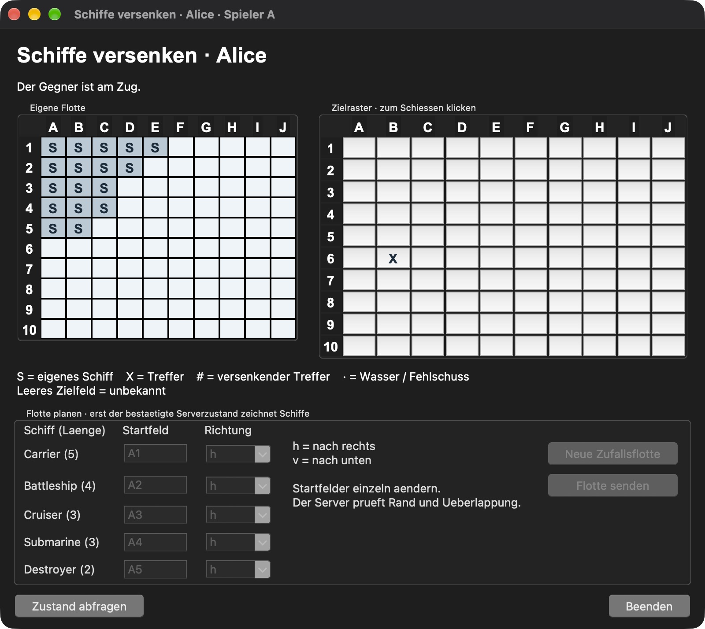
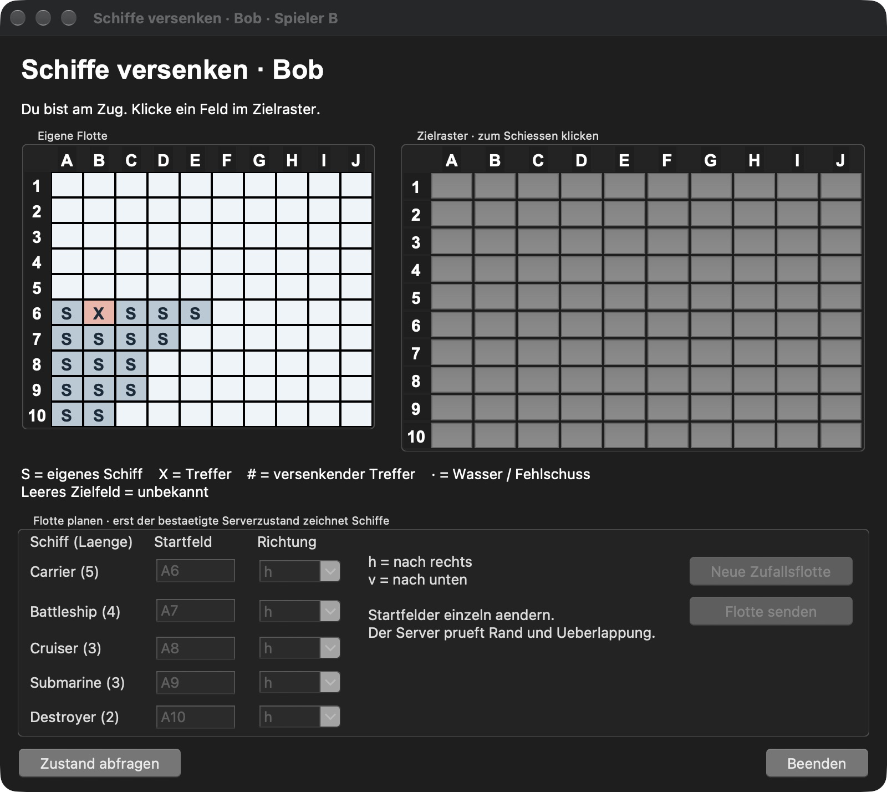

# Tatsächliche lokale Prüfung — Kursmeilenstein 4

27.10.2026, Europe/Zurich. Umgebung: macOS, Python 3.14.10, Tk 9.1.
Alle folgenden Versuche liefen auf einem Gerät. Der Schulnetz-Nachweis mit
zwei fremden Clientrechnern ist weiterhin offen.

## Gesamttests nach dem Strukturumzug

```bash
.venv/bin/python tools/run_tests.py
```

**84 Tests bestanden, keine Fehler, keine Skips**, 5.107 Sekunden.
Abschliessender Rohlog: [tests_final.txt](04_local/tests_final.txt).
Der frühere Lauf mit 81 Tests bleibt unverändert als [tests.txt](04_local/tests.txt) erhalten.

| Gruppe | Anzahl |
|---|---:|
| M0: Echo-CLI | 1 |
| M2: Brett, Kern, lokale Partie | 26 |
| M3: Transport und TCP-/CLI-Integration | 32 |
| M4: echte GUI, Serverzustände, Protokoll, Nachweiswerkzeug | 25 |
| Gesamt | 84 |

Die GUI-Tests verwenden echte Tk-Widgets und lokale Socketpaare. Die
TCP-Suite startet echte Verbindungen und eigene CLI-Prozesse. Die zwei
Protokolltests führen die vollständige dokumentierte Partie durch den
Servereingang aus; deren In-Memory-Sockets sind ausdrücklich kein weiterer
TCP-Nachweis. Der M2-Aufruf wurde zusätzlich aus `/private/tmp` mit absolutem
Starterpfad ausgeführt: 26 Tests bestanden. Damit sind die Tests nicht vom
aktuellen Terminalverzeichnis abhängig.

## Zwei echte Fenster und ein Serverprozess

Vorher festgehaltene Erwartungen: [04_expected_results.md](04_expected_results.md).

```bash
.venv/bin/python tools/run_gui_demo.py --output docs/evidence/04_local --pause-for-capture
```

Der Lauf startete am 27.10.2026 um 16:58:12 und endete um 17:01:03 MEZ.
Ein Serverprozess und zwei echte GUI-Clients liefen über TCP/127.0.0.1.
Das Werkzeug betätigte die normalen Platzierungs-/Schussknöpfe und prüfte:

- Warten, Beitritt und ungefragten Spielstart;
- verschiedene, vom Server bestätigte Flotten;
- Treffer B6 in Alices Zielraster und Bobs eigener Flotte, B am Zug;
- private Ablehnung ausser der Reihe ohne Änderung beider Zustände;
- Wasser auf J10 und private Doppelbeschuss-Ablehnung;
- vollständige Partie mit 33 gültigen Schüssen, Sieger A in beiden Zuständen;
- registrierten Fensterkreuz-Handler, Abbruchanzeige, leeren Reset und Ersatzbeitritt;
- ausschliesslich die jeweilige eigene Flotte in sämtlichen Zustandsnachrichten.

Tatsächliches Ergebnis: **PASS**, siehe [result.json](04_local/result.json).

Die nach demselben Treffer aufgenommenen Originalfenster zeigen konsistente
Spielersichten: Alice kennt ihre Flotte und den Treffer B6; Bob kennt seine
andere Flotte und denselben Treffer. Alices Status zeigt den Gegner am Zug,
Bobs Status „Du bist am Zug“. Beide Aufnahmen stammen aus derselben
angehaltenen Partie, bevor weitere Züge ausgeführt wurden.

| Alice / A | Bob / B |
|---|---|
|  |  |

Die Einzelaufnahmen wurden über die native Fensteransicht erzeugt und
unverändert gespeichert. Es wurde kein Spielfenster nachgezeichnet.
Die automatische Gesamtbildaufnahme über `screencapture` war in dieser
Umgebung nicht verfügbar; deshalb liegt der lokale Bildnachweis als Paar
echter Fensteraufnahmen vor. Für die Schulabgabe ist das gemeinsame Bild
im tatsächlichen Fremdrechnerversuch gemäss Checkliste noch zu erstellen.

## Ablehnungen und tatsächliche Nachrichten

```text
Fehler NOT_YOUR_TURN: Spieler A ist nicht am Zug
Fehler DUPLICATE_SHOT: auf B6 wurde bereits geschossen
```

Die beiden Fehlermeldungen stehen in `result.json`. Der vollständige
[Clientmitschnitt](04_local/client_messages.jsonl) belegt Empfänger und
Reihenfolge. Die Integration vergleicht beide Zustände vor und nach jeder
Ablehnung und prüft, dass der Gegner keine Fehlermeldung erhält.

**Dieser Mitschnitt enthält die erlaubten Ansichten beider Testclients und
absichtlich bekannte Testflotten.** Er ist ein isolierter Testnachweis,
kein öffentlicher Live-Mitschnitt und keine einzelne Clientansicht.
Alice erhält darin nie Bobs unbeschossene Schiffsfelder als Gegnerflotte.

Der [Server-Terminalmitschnitt](04_local/server.txt) enthält ausschliesslich
Metadaten: Verbindung, Slot, Typ und eigene Fehlercodes. Er wurde auf
Flotten-/Zustandspayloads und Tracebacks geprüft. Alle Clientadressen sind
Loopback-Adressen; sie werden nicht als fremde Rechner ausgegeben.

## Gefundene Fehler und Grenzen

Der erste gemeinsame Lauf hatte einen echten Tk-Lebenszyklusfehler:
ein sterbender Netzwerkthread konnte die letzte Referenz auf Tk-Variablen
freigeben. Worker halten jetzt nur Socket, Queues und Stop-Ereignis;
die GUI gibt ihre Tk-Variablen im Hauptthread frei. Ein Regressionstest
prüft den tatsächlichen Freigabethread.

Das unabhängige Review fand ausserdem synthetische Leerzustände bei
`gameStart`/`opponentLeft`. Diese Ereignisse ändern jetzt nur den Status;
das Raster wartet auf die tatsächliche folgende Zustandsnachricht.
Die korrigierten Fälle sind im grünen Gesamtlauf enthalten.

Der erste Bildversuch brach an der Bildschirmaufnahme ab, nicht an einer
Spielaktion. Sein Teilmitschnitt bleibt unter
`04_diagnostics/01_capture_attempt/` erhalten und wird nicht als erfolgreiche
Partie gezählt. Der anschliessende vollständige Lauf und die Originalbilder
sind oben getrennt belegt.

Eine eigene Ausführung auf Windows/Linux oder Python 3.12 ist nicht belegt.
Zwei Personen, fremde Geräte und das menschliche Gegenlesen bleiben offen;
der [Anforderungsabgleich](../status/04_requirements.md) führt sie getrennt.


## Abschliessende Review-Korrekturen und erneuter Lauf

Drei neue Regressionstests sichern das Nachweiswerkzeug ab: bestehende
Ausgabeordner werden vor jedem Schreibzugriff abgelehnt; ein fehlgeschlagener
abschliessender Serverlogcheck speichert FAIL statt PASS; ein sauberer
vollständiger Lauf speichert PASS. Ohne `--output` wird ein neuer
zeitgestempelter Ordner gewählt.

Nach dieser Änderung wurde die komplette GUI-/TCP-Partie am 27.10.2026
um 17:09:54–17:09:56 MEZ erneut ausgeführt: **PASS**, dieselben sieben
Funktionsprüfungen einschliesslich 33 Schüssen, Privatheit, Abbruch und Ersatz.
Die neue Ausgabe liegt separat unter [04_final_run/result.json](04_final_run/result.json),
[Serverlog](04_final_run/server.txt) und [Clientmitschnitt](04_final_run/client_messages.jsonl).
Der erste erfolgreiche Lauf und seine Originalbilder wurden nicht überschrieben.

Das unabhängige abschliessende Review fand nach den Korrekturen keine
weiteren Codefehler. Dokumentlinks, Quellenkompilierung und `git diff --check`
wurden zusätzlich geprüft. Das menschliche Gegenlesen der Kursunterlagen
bleibt davon getrennt offen.
